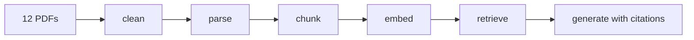

# Payer Policy Copilot

A retrieval-augmented chatbot that answers questions about US insurer coverage of three Amgen
drugs (Repatha, Prolia, Otezla) from Aetna, Cigna and UnitedHealthcare policies, an Aetna
formulary extract and the FDA labels. Every answer cites the policy section and date it came
from, and the bot says so when the documents don't contain the answer. For market access
work, that turns a search through several long PDFs into a cited answer you can check in one click.

**Live demo:** [payer-policy-copilot on Streamlit Community Cloud](https://payer-policy-copilot-37qjb6etypma8bigmygtbc.streamlit.app/)
(password available on request). Free hosting: the first load can take 1-3 minutes.

## Architecture

- **parse:** page text via PyMuPDF; repeated headers/footers removed by frequency; version dates recorded.
- **chunk:** split at the policies' own headings, AND/OR criteria kept together, formulary rows rebuilt as sentences.
- **embed:** `nomic-ai/nomic-embed-text-v1.5` (chosen because 43% of chunks exceeded bge-small's 512-token limit) into Chroma.
- **retrieve:** top 8, filtered by the insurer and drug named in the question; questions naming 2+ insurers or drugs get one search per insurer/drug.
- **generate:** Claude Haiku 5.5 answers only from numbered sources; code checks every `[S#]` citation.

## Evaluation

25 questions (8 criteria, 3 duration, 3 formulary, 3 comparison, 2 label, 2 tricky,
4 unanswerable), phrased as an analyst would ask. Retrieval is scored with evidence phrases
that code checks are specific to one document; answers are graded by Claude Opus 5.5 against
expected facts, with a random sample of grades and three expected answers checked by hand.

| Retrieval (21 answerable questions) | hit@3 | hit@8 | recall@8 | MRR |
|---|---|---|---|---|
| Section chunks + context line, filter on (deployed) | 0.62 | **0.95** | **0.90** | **0.61** |
| Section chunks + context line, no filter | 0.48 | 0.71 | 0.66 | 0.47 |
| Section chunks, no context line, no filter | 0.48 | 0.52 | 0.48 | 0.38 |
| Fixed 500-token chunks, no filter | 0.29 | 0.52 | 0.40 | 0.28 |

The chunking comparison uses no-filter rows because the fixed set's formulary chunks carry no
drug label, so a drug filter would penalise it for a labelling reason, not its chunking.

| Answers (deployed setup) | Correct | Partly | Wrong | Correctly refused | Wrongly refused | Hallucinated |
|---|---|---|---|---|---|---|
| 25 questions | 17 | 2 | 1 | 4 of 4 | 1 | **0** |

The set was later extended to 27 questions with 2 drug-comparison questions
([`eval/results/20261105-224643/`](eval/results/20261105-224643/)); the original 25 kept identical grades.

Three of the four failures are retrieval misses where the model said the sources didn't cover
the point; the fourth is an ambiguous question. Cost per answer is about $0.0009 (Haiku);
median end-to-end time is 3.4 s on a local CPU. Results: `eval/results/20261104-205239/`.

## Experiments

| Change | Result | Decision |
|---|---|---|
| Per-insurer retrieval for comparisons | Comparison recall@3 0.33 → 0.50, recall@8 unchanged at 0.50, no grade changes: the right chunks rank too low *within* each insurer. | Kept |
| Cross-encoder re-ranker (`bge-reranker-v2-m3`) | q04 evidence 1/3 → 2/3, q17 0/2 → 1/2, q19 1/2 → 0/2; 42-73 s per query on CPU, peak memory 1.6 → 2.9 GB. | Off (behind a flag) |
| Per-drug retrieval (bug found testing the live app) | "Repatha vs Prolia" retrieved only Prolia chunks, because 2 named drugs disabled the drug filter; now 4 + 4 per drug. All 25 original questions unchanged; 2 new drug-comparison questions added (both partly, evidence recall@8 0.00 and 0.33: ranking within each label). | Kept |

## Limitations and next steps

- **Small test set:** one of 21 answerable questions is about 5 points; a larger held-out set is next.
- **Ranking in long documents:** remaining misses rank 5-21, which also explains the two partial drug-comparison answers; try a faster re-ranker or hybrid keyword search.
- **Coverage:** Aetna's Otezla policy is from 2024 and its Repatha policy from 2025; no UHC Repatha policy.
- **No follow-up memory** (each question stands alone), and free hosting is slow to wake.

## Data, engineering, running, security

- **Data:** 12 documents (322 pages). The PDFs aren't redistributed here; the search index lives in a private Hugging Face dataset that the app downloads at startup.
- **Engineering:** fixed a page-number rule that deleted real doses ("60 mg/mL"); rebuilt formulary tables with PyMuPDF table detection; deployed with CPU-only PyTorch and a SQLite shim for Debian 11.
- **Run locally:** `pip install -r requirements-dev.txt`, put the PDFs in `data/pdfs/` and `ANTHROPIC_API_KEY` / `APP_PASSWORD` in `.env`, then run `parse.py`, `chunk.py`, `embed.py` and `streamlit run app.py`.
- **Security:** password gate (2 s delay, lock after 5 attempts), 20 questions per session and 150 per day, secrets only in the host's settings, and a read-only token scoped to the one private dataset.

Not coverage or medical advice: answers reflect the listed documents as of their version dates.
